# Análisis de 5 reels de referencia · 23-oct-2026

Ernesto grabó la pantalla de 5 videos que le gustaron como **referencia** para la estrategia de contenido de Casa Viva. Aquí está lo que hace cada uno, segundo a segundo, y la fórmula que sacamos de ellos. La fórmula ya está convertida en la skill `video-formula-casa-viva` (`C:\Users\Ernesto\.claude\skills\video-formula-casa-viva\SKILL.md`).

- **Cómo se hizo:** copia de los videos en el scratchpad, 1 fotograma por segundo con ffmpeg, hojas de contacto 3×3 vistas una por una, detección de cortes (`select=gt(scene,0.3)`), volumen por tramos (`volumedetect`) y audio transcrito con Groq Whisper `large-v3` / `large-v3-turbo` en el VPS. La clave no se imprimió y los temporales de `/tmp` se borraron. Los videos originales no se movieron.
- **Calidad:** son grabaciones de pantalla a 288×640 (la 4 a 358×642), así que los textos pequeños se leen a medias. Las grabaciones duran más que los reels porque la interfaz de Instagram sale encima, y en el 2 se ve el final congelado.
- **Derechos:** son videos de otras personas. Aquí van **resumidos y con nuestras palabras**, no copiados (no se transcribe la letra de canciones). Sirven para aprender la estructura, no para copiar el contenido.
- **Fotogramas clave:** en `fotogramas/` (jpg de 240 px, el nombre dice el segundo).

| # | Archivo | Duración | Cuenta (en pantalla) | Nicho | Voz | Truco principal |
|---|---|---|---|---|---|---|
| 1 | `121320-A5E0…mp4` | 51 s | @thebranding.ai | marketing / psicología del contenido viral | sí, inglés | comparar A/B con cifras + lista de 3 + bucle |
| 2 | `121331-A58C…mp4` | 36 s (el reel dura ~19 s) | @mariebrealty (verificada) | inmobiliaria (casas en EE. UU.) | no; música pop con letra | recorrido POV al ritmo de la música |
| 3 | `121411-A509…mp4` | 49 s | @carla7oledo | storytelling / marca personal (español rioplatense) | sí, español | «no eres tú, es el método» + antes/después |
| 4 | `121412-A5E7…mp4` | 14 s | no aparece (video crudo, sin interfaz de Instagram) | lugar turístico con palmas y playa | no (solo ambiente, casi en silencio: −57 dB) | plano secuencia real desde un balcón |
| 5 | `121412-A5D1…mp4` | 56 s | @mariebrealty (verificada) | inmobiliaria | sí, inglés (diálogo) | parodia de una película (llamada de *Scream*) + preguntas y respuestas + bucle |

---

## Video 1 · @thebranding.ai · «mismo truco, distintos creadores» (51 s)

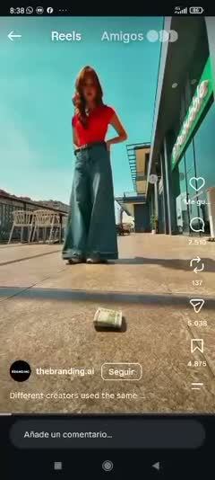 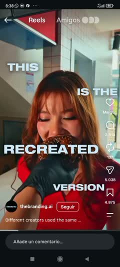 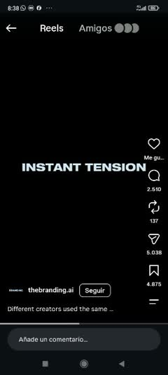

- **Gancho (0–3 s):** plano bajo, a ras del suelo: un fajo de billetes en primer plano y una chica que camina hacia él. A los 2 s una mano coge el dinero. Ya hay tensión antes de que nadie hable. Texto: ninguno. Voz: el saludo del video original de una hamburguesería.
- **Estructura:**
  - 0–4 s · el video «recreado» (hamburguesería XYZ Burger): billete en el suelo, la chica cae y entra.
  - 4–7 s · texto enorme repartido por la pantalla: «ESTA ES LA VERSIÓN RECREADA», con la chica mordiendo una dona.
  - 7–9 s · maqueta de un móvil con «4,2 M» de vistas y una flecha dibujada.
  - 9–15 s · el video **original** (un gimnasio): dona en la puerta, saludo y bienvenida.
  - 15–18 s · texto apilado «Y ESTE ES EL ORIGINAL CON MÁS DE **50** MILLONES DE VISTAS», con el «50» gigante.
  - 18–21 s · fondo negro: «Distintos creadores, la misma psicología», y los dos videos lado a lado con «¿VIRAL?».
  - 21–40 s · **lista de 3 disparadores** sobre fondo negro: 1) tensión al instante, 2) bucle de curiosidad (con el meme de la rana Gustavo), 3) giro inesperado. Números «2» y «3» gigantes con letra serif y recortes de los videos.
  - 40–44 s · moraleja: «Esa es la fórmula · no reinventes cada idea · busca un patrón que funcione · hazlo tuyo».
  - 44–48 s · **CTA:** «Comenta HOOKS» y te mandan 5.000 ganchos. Detrás pasa, borrosa, la lista de ganchos: se ve que el regalo existe.
  - 49–51 s · vuelve el plano del principio (el billete en el suelo): **bucle perfecto**.
- **Cortes:** 22 cortes detectados. Las tarjetas de texto cambian cada 0,7–1,5 s. Las tomas de video duran 1–3 s.
- **Planos:** contrapicado a ras del suelo, plano medio, detalle de manos y comida, y capturas de pantalla dentro de un marco de móvil.
- **Texto en pantalla:** de 1 a 4 palabras, **mayúsculas muy gruesas**, blanco con sombra, centrado o repartido por las esquinas; en las tarjetas va en el centro de la pantalla, nunca abajo. Los números van en serif fina enorme. Hace de subtítulo palabra por palabra.
- **Música y sonido:** voz en off rápida y cercana, con música de fondo suave.
- **Transiciones:** corte seco; las tarjetas negras separan las partes.
- **CTA final:** comentar una palabra clave y recibir un regalo concreto que se ve en pantalla.
- **Truco psicológico:** prueba social con cifras (4,2 M frente a 50 M), comparar A/B, lista numerada, bucle de curiosidad, regalo a cambio de un comentario y bucle visual al final.
- **Audio (resumen):** saluda la hamburguesería; «esta es la versión recreada, con 4,2 millones de vistas»; saluda el gimnasio; «y este es el original, con más de 50 millones; distintos creadores, la misma psicología»; explica los 3 disparadores (algo está a punto de pasar → el cerebro se engancha; se abre una pregunta y te quedas por la respuesta; el final sorprende y por eso se repite y se comparte); «no reinventes cada idea, encuentra un patrón y hazlo tuyo»; «comenta HOOKS y te mando 5.000 ganchos».

## Video 2 · @mariebrealty · recorrido de una casa (reel de ~19 s)

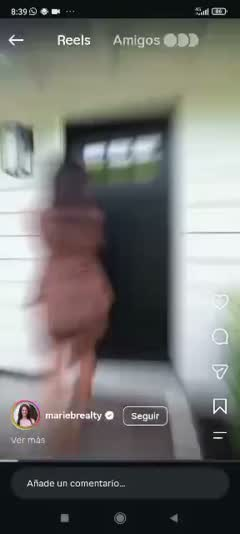 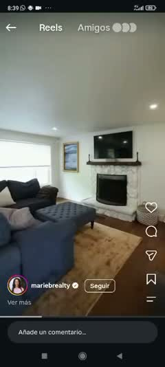 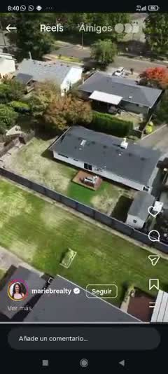

- **Gancho (0–3 s):** la agente entra en el cuadro caminando rápido hacia la puerta, con movimiento borroso. A los 1–3 s, primer plano de sus manos abriendo la puerta negra. Es un «entra conmigo». Sin texto. La música arranca con un «¡para!» cantado.
- **Estructura:** 0–4 s puerta → 4–8 s salón y cocina (cámara que avanza, plano general) → 8–10 s patio y vista de dron desde arriba → 10–17 s pasillo con barrido, comedor, 2 dormitorios, baño y patio, **cada vez más rápido** → 18–19 s dron sobre la casa. Desde los 19 s la grabación se queda congelada en el dron y sin sonido (el reel ya había terminado). A los 34 s Ernesto pasa al siguiente video (el 1).
- **Cortes:** cortes al ritmo de la música, cada 1,5–3 s al principio y **cada 0,5 s** entre los 14 y los 17 s (aceleración final).
- **Planos:** cámara que avanza como si caminaras tú, barridos rápidos para pasar de una habitación a otra, gran angular y dron.
- **Textos y subtítulos:** ninguno en pantalla; solo el pie de Instagram.
- **Música:** canción pop conocida, con letra, alta (−10 dB de media). La letra no se transcribe.
- **Transiciones:** barrido rápido y desenfoque de movimiento entre las habitaciones.
- **CTA:** ninguno en el video (estará en el pie).
- **Truco psicológico:** punto de vista (te metes en la casa), placer visual al ritmo de la música, curiosidad por ver qué hay detrás de la puerta, y ningún texto que leer, así que dan ganas de verlo otra vez.
- **Audio:** solo la canción (sin voz hablada).

## Video 3 · @carla7oledo · «No sos aburrido» (49 s)

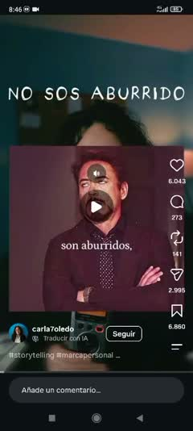 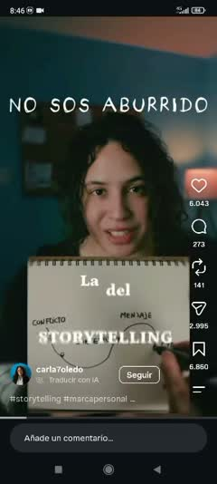 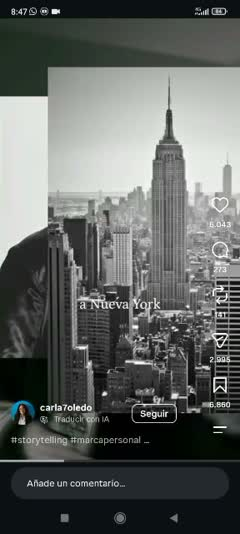

- **Gancho (0–3 s):** título fijo arriba, «NO SOS ABURRIDO» (letra fina de imprenta y muy espaciada), que se queda los primeros ~10 s. En el segundo 0 sale un meme (un actor famoso poniendo los ojos en blanco) sobre la palabra «aburridos». La voz entra con el dolor del público: si sientes que tus videos son aburridos… no eres tú.
- **Estructura:**
  - 0–8 s · el dolor y le quita la culpa al público: no eres tú, es la estructura que usas.
  - 8–15 s · libreta real de papel: dibuja «la estructura clásica» (inicio, desarrollo y final, en orden).
  - 15–21 s · ejemplo aburrido **en blanco y negro** (la historia de Stallone contada en orden) y termina con «Aburrido.».
  - 21–25 s · vuelve el color y explica por qué no sirve en redes: tarda mucho en llegar al conflicto. Tacha en la libreta.
  - 25–31 s · la buena: conflicto → contexto → mensaje → llamada a la acción, escrita en la libreta.
  - 31–36 s · regla: empieza por el conflicto, el momento de más tensión o el resultado.
  - 36–43 s · mismo ejemplo bien contado: el peor momento, cuando tuvo que vender a su perro, con fotos reales y el texto «DESPUÉS LO RECUPERÓ».
  - 43–46 s · rodea «CONFLICTO» en la libreta.
  - 46–49 s · autoridad («la uso en todos mis videos y con mis clientes») y CTA: si necesitas ayuda con tus videos, comenta.
- **Cortes:** cada 1,5–3 s entre la cara, la libreta y las fotos de ejemplo. Lo único fijo es el título de los primeros 10 s.
- **Planos:** primer plano a cámara con micrófono delante (estilo pódcast), libreta desde arriba con su mano escribiendo, y fotos de archivo.
- **Subtítulos:** serif blanca, de 2 a 4 palabras, **en el centro de la pantalla** (no abajo), al ritmo de la voz.
- **Música:** voz sola, muy limpia (Whisper no tuvo ni una duda), quizá con música muy baja.
- **Transiciones:** corte seco. **El cambio de color a blanco y negro marca «lo malo»** y el color vuelve con «lo bueno».
- **CTA final:** comentar para recibir ayuda.
- **Truco psicológico:** quitarle la culpa al público (el enemigo es el método), antes/después (clásica frente a storytelling), un ejemplo famoso, mostrar el método a mano (prueba de que sabe) y autoridad.

## Video 4 · sin cuenta visible · paseo por un hotel o villa de playa (14 s)

 

- **Qué es:** un video crudo de móvil, sin la interfaz de Instagram y sin ningún texto. Desde un balcón, la cámara gira despacio: palmas, césped, casitas de tejas, setos en forma de laberinto, otra vez palmas, y termina mirando al mar con sombrillas en la arena.
- **Gancho (0–3 s):** nada preparado: palmas y verde con luz de día nublado. Funciona por el lugar, no por la edición.
- **Estructura:** un solo plano secuencia de 14 s que **termina en lo mejor (el mar)**.
- **Cortes:** ninguno. **Texto, subtítulos, música y CTA:** ninguno; solo un poco de ambiente casi en silencio (−57 dB). Whisper no encontró voz.
- **Truco psicológico:** se nota real («así es de verdad, sin filtros») y guarda lo mejor para el final (el mar aparece en el segundo 10).
- **Lección para nosotros:** solo no engancharía, pero es la mejor **prueba**: un paseo de 3–5 s grabado con el móvil en la tienda real de Nuevo Vedado vale como «fotos reales» dentro de la fórmula.

## Video 5 · @mariebrealty · «la llamada de terror» de una casa (56 s)

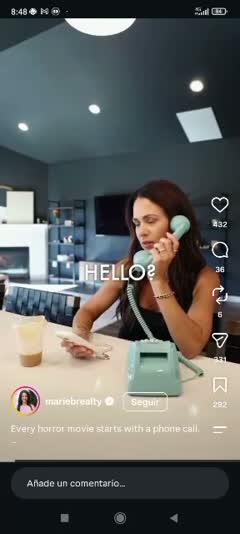 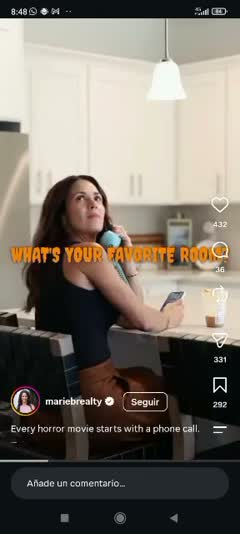 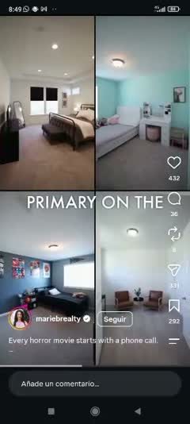

- **Gancho (0–3 s):** la agente toma café con el móvil en la mano y suena un **teléfono antiguo** de color menta. Lo coge: «¿Diga?» (texto «HELLO?»). Un objeto raro y un sonido: está a punto de pasar algo.
- **Estructura (parodia de la llamada de *Scream*):** cada pregunta de la voz misteriosa = una habitación nueva:
  - «¿Cuál es tu peli de miedo favorita?» → «Pagar el alquiler» (le toca el dolor al público con humor) → exteriores.
  - «¿Tu habitación favorita?» → el salón de techo alto → «bueno, el parque de al lado» (dron del parque) → «eso no es una habitación» → «aquí sí».
  - «¿Cuántos dormitorios?» → «cuatro, el principal abajo y un loft arriba» → **pantalla dividida en 4** con los dormitorios → el loft con ajedrez y dardos («¿un loft para qué?», «¿para esconderse?»).
  - «¿Cuál es el precio?» → «¿no te gusta un poco de misterio?» (**no da el precio**: para saberlo hay que escribir).
  - «No tengo el préstamo aprobado» → «eso no me asusta, tengo un banquero en marcación rápida» (**le quita la objeción** de cómo pagar).
  - «¿Cuándo quieres verla?» → «la estoy viendo ahora mismo» → «¿entonces ya viste la cocina?» → suelta el teléfono y sale corriendo (el giro de terror) → fachada, dron → **vuelve al café del principio (bucle)**.
- **Cortes:** cada 1,5–2,5 s: una frase = un plano nuevo.
- **Planos:** plano medio de ella con el teléfono, generales de cada habitación, dron, pantalla dividida y un plano largo de ella sentada (35–41 s) para que se lea la respuesta.
- **Texto en pantalla:** dos estilos según quién habla. **Las preguntas, en letra naranja de terror** (estilo Halloween); **las respuestas, en mayúsculas blancas finas**. Van en el centro de la pantalla y palabra por palabra al ritmo de la voz. El pie de Instagram dice que toda peli de terror empieza con una llamada.
- **Música:** diálogo con música de suspense baja.
- **CTA:** implícito: el precio es un misterio (hay que escribir). La compra parece fácil porque ya respondió a la objeción.
- **Truco psicológico:** parodia de un formato que todo el mundo conoce, humor, preguntas y respuestas que en realidad son **las objeciones del comprador** (habitaciones, precio, cómo pagar), precio escondido (curiosidad), giro final y bucle.

---

## Lo que tienen en común

1. **Vertical 9:16 y sin presentación.** Ninguno empieza con un logo ni con un «hola, soy…». El primer fotograma ya se mueve.
2. **En el primer segundo algo está a punto de pasar:** dinero en el suelo, una puerta que se abre, un teléfono que suena o una frase que te dice «tú». Es la «tensión al instante» que el video 1 explica.
3. **Cambia algo cada 1–2 s:** plano nuevo, palabra nueva o zoom. En los que tienen música, el corte va al ritmo y se acelera al final.
4. **Una estructura que se ve:** lista numerada (1), recorrido (2 y 4), antes/después (3) o preguntas y respuestas (5).
5. **Texto corto, grande y en el centro:** de 1 a 4 palabras, sincronizado con la voz, nunca abajo (allí lo tapa la interfaz de Instagram).
6. **Lugares y personas reales** (casas, gimnasio, tienda, libreta a mano). Nada parece de banco de imágenes.
7. **Humor o algo que ya conoces:** un meme (1 y 3), una película (5) o una canción famosa (2).
8. **Final:** palabra clave + regalo que existe (1 y 3), precio escondido (5) o **bucle** al primer fotograma (1 y 5).

## La fórmula para Casa Viva (25 s; máximo 35)

Nuestro reel del 12-oct perdió al 70 % antes de los 20 s y en Cuba los datos cuestan, así que más corto que las referencias.

| Paso | Segundos | Qué pasa | De dónde sale |
|---|---|---|---|
| 1. Tensión | 0–2 | Algo a punto de pasar + 3–6 palabras con el dolor («¿Otra vez sin corriente?»). Movimiento en el primer fotograma. | 1, 2, 5 |
| 2. Promesa (bucle abierto) | 2–4 | Número o pregunta que obliga a quedarse («3 cosas… la 3.ª casi nadie la tiene»). | 1, 3 |
| 3. Recorrido | 4–16 | 1 idea = 1 plano de 1,5–2 s: producto real, beneficio en 1–4 palabras y precio que «salta». | 2, 5 |
| 4. Giro | 16–19 | Lo inesperado: antes/después (blanco y negro → color), respuesta graciosa o dato que sorprende. | 1, 3, 5 |
| 5. Prueba + garantía | 19–22 | Paseo de 3 s por la tienda real o rejilla de fotos reales, «lo revisas delante del mensajero» y «quedan N». | 4, 1 |
| 6. Oferta + CTA | 22–25 | Una sola acción: palabra clave + regalo concreto («Comenta APAGÓN y te decimos cuál necesita tu casa»). Logo. Sin enlace ni teléfono (D96). | 1, 3 |
| 7. Bucle | 25–25,5 | Fundido a la imagen del segundo 0. | 1, 5 |

**3 variantes:**
- **A · Producto** (público: clientes; lo reenvían los gestores y las gestoras con su enlace): problema → 3 productos reales con precio y existencia → fotos reales → «Comenta <PALABRA>».
- **B · Captación de gestores y gestoras** (Revolico y redes): «No te falta saber vender, te falta catálogo» (estilo del video 3) o preguntas y respuestas (estilo del video 5: «¿Cuánto invierto?» «Nada.»). Prueba con números reales y sin nombres (D94) y urgencia solo si es real. CTA: **«Escribe VENDER»** → el bot manda el kit (conocimiento #302).
- **C · Oferta VIP** (grupo «Casa Viva · Clientes VIP»): beneficio exclusivo y real (puntos del piloto: 100 puntos = 2 USD; solo para el grupo), sin precio en pantalla (D97: en el grupo no hay precios). CTA: «Escribe QUIERO por WhatsApp».

Detalle completo, plantilla de guion, producción con HyperFrames, lista de revisión y calendario: skill `video-formula-casa-viva`.
